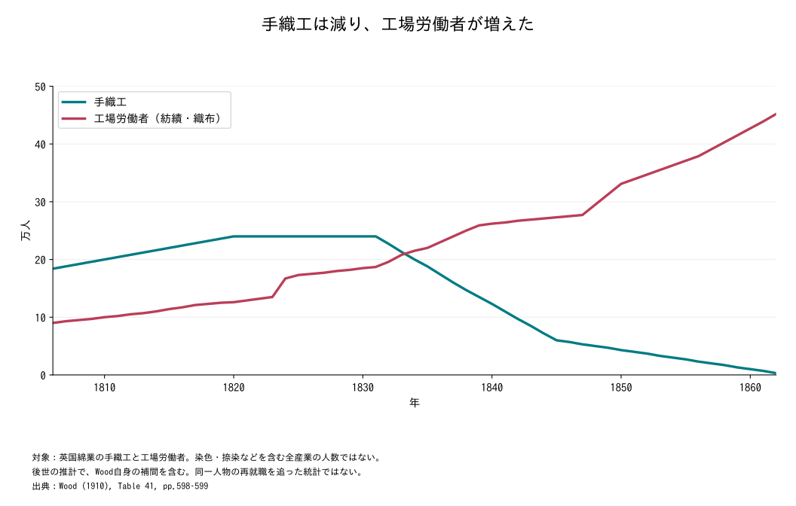

# 人間には、車庫がない — 歴史統計の裏付け資料

PLAO-DAS掲載予定のコラム「人間には、車庫がない — 200年前の産業革命と、AIが働く未来」のための調査資料です。2026年11月17日に確認した資料と計算をまとめました。初版は公開前確認用に作成しました。その後のユーザーによる掲載と採用済みの修正・ライセンス判断は[PUBLICATION_DECISIONS.md](PUBLICATION_DECISIONS.md)に記録しています。独自部分の公開主体はPLAOです。このパッケージの作成時点では、この更新の再アップロード・pushはまだ行っていません。GitHub更新はユーザーが承認しており、実行結果はコミット履歴で確認できます。

19世紀の英国で機械が布を織るようになったとき、仕事の数と賃金はどう変わったのでしょうか。本資料は、昔の統計から読み取れることと、読み取れないことを分けます。現代のAIが将来失わせる仕事の数を推計するものではありません。

## 公開情報

- 公開主体：PLAO
- 研究資料の初公開日：2026年11月18日
- 調査・計算の基準日：2026年11月17日
- [研究解説ページ・一般読者向けダウンロード](https://plao-das.com/lab/research_industrial_revolution/)
- [関連コラム](https://plao-das.com/columns/humans-have-no-garage.html)
- [GitHubリポジトリ](https://github.com/plaodas/research-textile)：公開。データ・コードを閲覧できます。

## 調べた範囲

主な対象は1800〜1850年の英国綿業です。変化の前後を見るため、一部を1806〜1862年まで広げました。中心となる統計は、George Henry Woodが1910年に当時の資料から再構成した、手織工と工場労働者の人数・週賃金です。工場には布を織る人だけでなく、糸を紡ぐ人なども含まれます。染色・捺染などは含まず、産業のすべてを数えたものではありません。[Wood原資料](https://zenodo.org/records/1941698/files/article.pdf)

## 分かったこと

| 年 | 手織工 | 工場労働者 | 二群の合計 |
|---|---:|---:|---:|
| 1831 | 240,000人 | 187,000人 | 427,000人 |
| 1847 | 53,000人 | 277,000人 | 330,000人 |
| 1859 | 13,000人 | 415,000人 | 428,000人 |

1831年の人数を合計が再び上回る年は、推計表の上では1859年です。**1859−1831＝28年**。これは労働者を毎年数えて実測した期間でも、一人の失業期間でもありません。合計を押し上げたのは工場の増加で、手織工の人数が戻ったわけではありません。[人数CSV](data/employment.csv)・[計算の詳細](findings.md#雇用人数と28年)

生活費の変化を考慮した「実質賃金」でも違いがありました。各群の1806年をそれぞれ100とすると、手織工は1820年42.0、1850年43.5。工場労働者は104.3、126.5でした。異なる人々の平均であり、同じ人の給料を追った値ではありません。[実質賃金CSV](data/real_wages.csv)

1833年の製造業者の説明には、同種の布を手織工1人で週2反、機械織工と助手2人で週18〜20反織る例があります。人数で単純に割ると後者は1人9〜10反、比較例の4.5〜5倍です。年齢や作業時間がそろった実験や、産業全体の平均ではありません。[Baines原資料 p.240](https://archive.org/download/cottonmanufact00bain/cottonmanufact00bain.pdf)・[計算CSV](data/productivity_examples.csv)

## 分からなかったこと

失職した手織工本人が工場に入ったのか、別の仕事へ移ったのか、子供の世代が新しく働いたのかは、この集計からは分かりません。同じ人の所得が何年で戻ったかも**検証不能**です。産業の人数と、その産業で働いていた人の生活は別の対象です。[制約と追加資料](limitations.md)

工場の平均賃金が上がったことから、全員の労働条件が良くなったとも言えません。また、この歴史だけで、現代AIによる失業率や回復年数を予測することはできません。

## グラフを見る

- [雇用人数：SVG](charts/01_employment.svg) ／ [PNG](charts/01_employment.png)
- [実質賃金：SVG](charts/02_real_wages.svg) ／ [PNG](charts/02_real_wages.png)
- [合計の回復と手織工の減少：SVG](charts/03_employment_comparison.svg) ／ [PNG](charts/03_employment_comparison.png)
- [1833年の生産性比較：SVG](charts/04_productivity.svg) ／ [PNG](charts/04_productivity.png)

詳しい図の説明とWeb掲載用の代替テキストは[charts/README.md](charts/README.md)、主要値は[key_numbers.csv](data/key_numbers.csv)にあります。

## コラム本文との対応

| 本文の節 | 確認資料 |
|---|---|
| 機械が働き始めたころ | [生産性比較](findings.md#生産性の比較例) |
| 雇用規模の回復に28年 | [人数と計算式](findings.md#雇用人数と28年)、[賃金の計算](findings.md#実質賃金) |
| 2026年、もう一度機械が働き始めた | [体験談・研究・予測の区別](article_factcheck.md#体験談と将来予測) |
| 30年後の買い手は、誰なのか | [英国AI作品研究の検証](ai_evidence.md) |
| 未来の職人たち | [一般化できる範囲と表現上の注意](article_factcheck.md#歴史からaiへの一般化) |

提供された本文を一項目ずつ確認した[article_factcheck.md](article_factcheck.md)には、支持できる点と修正を勧める表現の両方を記載しています。本文そのものを黙って変更してはいません。

## 原資料・再現方法・公開条件

- [sources.md](sources.md)：正式な書誌、ページ、取得日、第三者資料の利用条件とリンク
- [data/README.md](data/README.md)：CSVの単位・列・欠損・計算式
- [reproducibility.md](reproducibility.md)：環境構築、計算・作図・テストの実行方法
- [LICENSE.md](LICENSE.md)：コード、文章・図、独自加工データのライセンスと適用範囲
- [publication_review.md](publication_review.md)：公開前に人間が確認する事項
- [PUBLIC_FILES.md](PUBLIC_FILES.md)：公開対象の一覧

第三者のPDF、元のExcel、転載図、OCR全文、コラムの未公開原稿は同梱していません。元の物価指数は公式リンクから読者自身が取得し、再計算できます。公開CSVは数値の独自転記と独自計算の結果です。原データ一式に新しいライセンスを付け直したものではありません。
